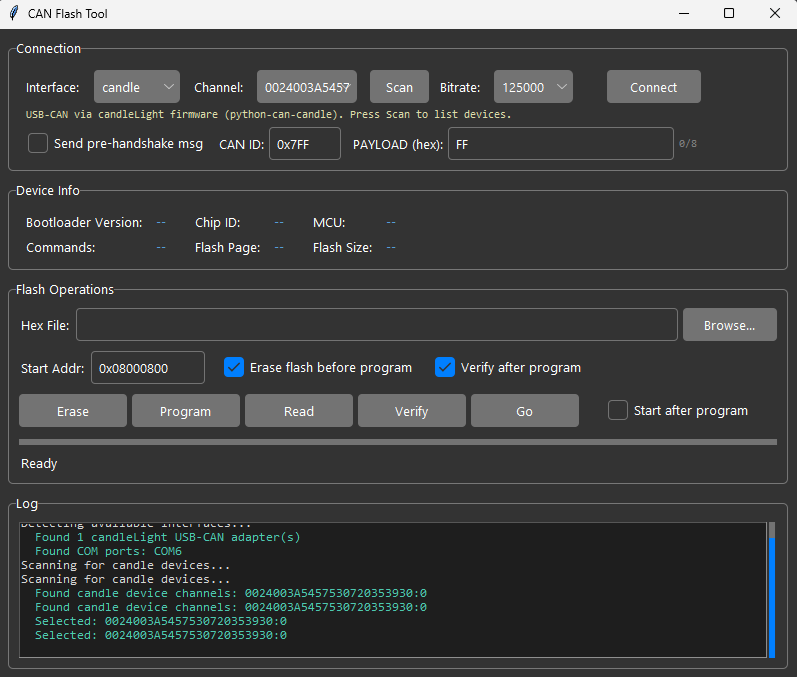

# CAN Flash Tool

A Python-based utility for flashing firmware over the CAN bus using a USB-CAN adapter (Canable/CandleLight with candleLight firmware) or over serial using USB-UART adapter.

<p align="center">
  
</p>

## Overview

This tool implements an adaptation of the **STM32 UART bootloader protocol** for CAN communication, where each byte is transmitted as a single CAN frame (DLC=1) — essentially "UART over CAN." It provides both a graphical user interface and a Python API for all bootloader operations.

Uses the `python-can-candle` package for USB-CAN adapter communication (replaces the older gs_usb/libusb approach).

## Protocol

| Parameter | Value |
|-----------|-------|
| Default CAN ID request (PC → MCU) | `0x3` |
| Default CAN ID response (MCU → PC) | `0x4` |
| ID format | 11-bit standard |
| DLC | Always 1 |

### Supported Commands

| Command | Code | Description |
|---------|------|-------------|
| Get | `0x00` | Get bootloader version and supported commands list |
| Get Version | `0x01` | Get bootloader version |
| Get ID | `0x02` | Get chip ID (e.g. 0x0440 for GD32E230) |
| Read Memory | `0x11` | Read memory content at specified address |
| Write Memory | `0x31` | Write data to memory (up to 256 bytes per block) |
| Erase Memory | `0x43` | Erase flash (global erase only) |
| Go | `0x21` | Jump to application entry point |

Each command uses XOR checksum validation for address and data payloads.

## Installation

```bash
# Install dependencies
pip install -r requirements.txt
```

### Dependencies

- `python-can-candle` — CAN bus communication via USB-CAN (candleLight firmware, includes python-can)
- `intelhex` — Intel HEX file reading/writing
- `pyserial` — Serial port enumeration (for slcan interface)
- `tkinter` — Built-in Python GUI library (included with Python)
- `PyInstaller` (optional) — For building standalone executables

## Usage

### Graphical Interface

```bash
python can_flash_gui.py
```

Features:
- Connect to CAN interfaces (candle, slcan, uart, virtual)
- Auto-scan available channels
- Display device info: bootloader version, chip ID, supported commands
- Flash firmware from Intel HEX (`.hex`) files
- Read device memory and save as HEX file
- Erase flash memory (global erase)
- Verify flashed content against HEX file
- Send Go command to start the application
- Dark theme (Azure ttk) UI with color-coded logging
- Progress bar for all operations
- Threaded operations — UI stays responsive
- Built-in bootloader simulator for testing without hardware (`--sim` flag)

#### Simulator Mode (No Hardware Required)

```bash
# Start the GUI with built-in simulator
python can_flash_gui.py --sim

# Or run the simulator standalone
python can_bootloader_sim.py
```

In the GUI, set: Interface = `virtual`, Channel = `test_bus`, Bitrate = `125000`, then click **Connect**.

The simulator emulates a device (Chip ID: 0x0440) with 64 KB of virtual flash memory and supports all bootloader commands.

### Python API (Scripting)

```python
from can_bootloader import CANBootloader

bl = CANBootloader(channel=0, bitrate=125000)
bl.connect()

try:
    # Synchronize with device
    bl.sync()

    # Get device information
    version, commands = bl.get()
    chip_id = bl.get_id()
    print(f"Version: 0x{version:02X}, Chip ID: 0x{chip_id:04X}")

    # Erase and program
    bl.erase_memory()
    bl.program_hex('firmware.hex')

    # Read memory back
    data = bl.read_memory(0x08000000, 256)
    print(f"First 256 bytes: {' '.join(f'{b:02X}' for b in data)}")

    # Launch the application
    bl.go(0x08000400)

finally:
    bl.disconnect()
```

### Building a Standalone Executable

```bash
# On Windows
build.bat

# Or manually with PyInstaller
pip install pyinstaller
pyinstaller --onefile --noconsole \
    --name "CAN_Flash_Tool" \
    --add-data "azure.tcl;." \
    --add-data "theme;theme" \
    --hidden-import candle \
    --hidden-import can.interfaces.slcan \
    --hidden-import can.interfaces.virtual \
    --hidden-import serial.tools.list_ports \
    --hidden-import intelhex \
    --hidden-import can_bootloader_sim \
    can_flash_gui.py
```

The executable will be created at `dist/CAN_Flash_Tool.exe`.

### Running Tests

```bash
# Full protocol test using virtual bus
python test_full.py
```

This runs a comprehensive test covering connection, sync, GET, GET_ID, read/write memory, erase, and verify — all on a simulated device.

## CAN Interface Support

| Interface | Description | Platform |
|-----------|-------------|----------|
| `candle` | USB-CAN adapters (candleLight firmware via python-can-candle) | Windows/Linux |
| `slcan` | Serial-line CAN (Lawicel SLCAN protocol) **NOT TESTED** | Windows/Linux |
| `uart` | USB-UART adapters | Windows/Linux |
| `virtual` | Virtual CAN bus for simulator/testing | All |

## Error Handling

The library provides three exception types:

- `BootloaderError` — Base exception for bootloader errors
- `NackError` — Device responded with NACK (command rejected)
- `TimeoutError` — No response from device within timeout period

Default timeouts:
- Response timeout: 2 seconds
- Connection timeout: 10 seconds

## License

This project is provided as-is for educational and development purposes.
